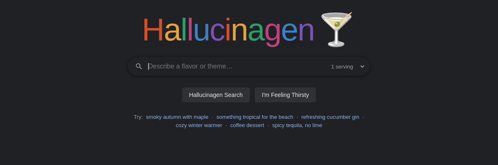
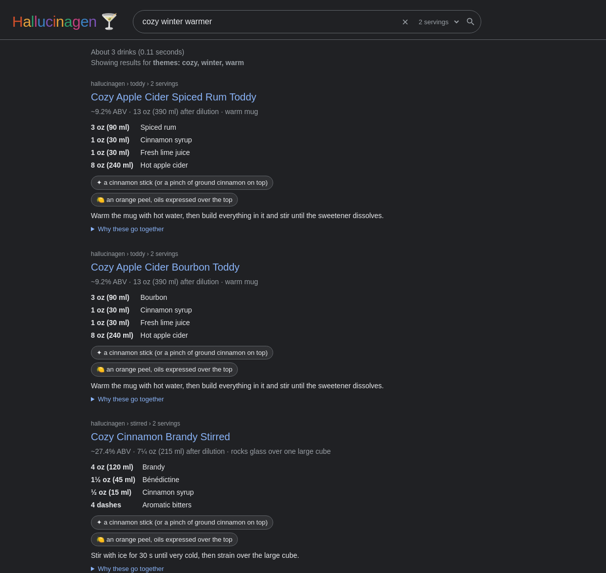
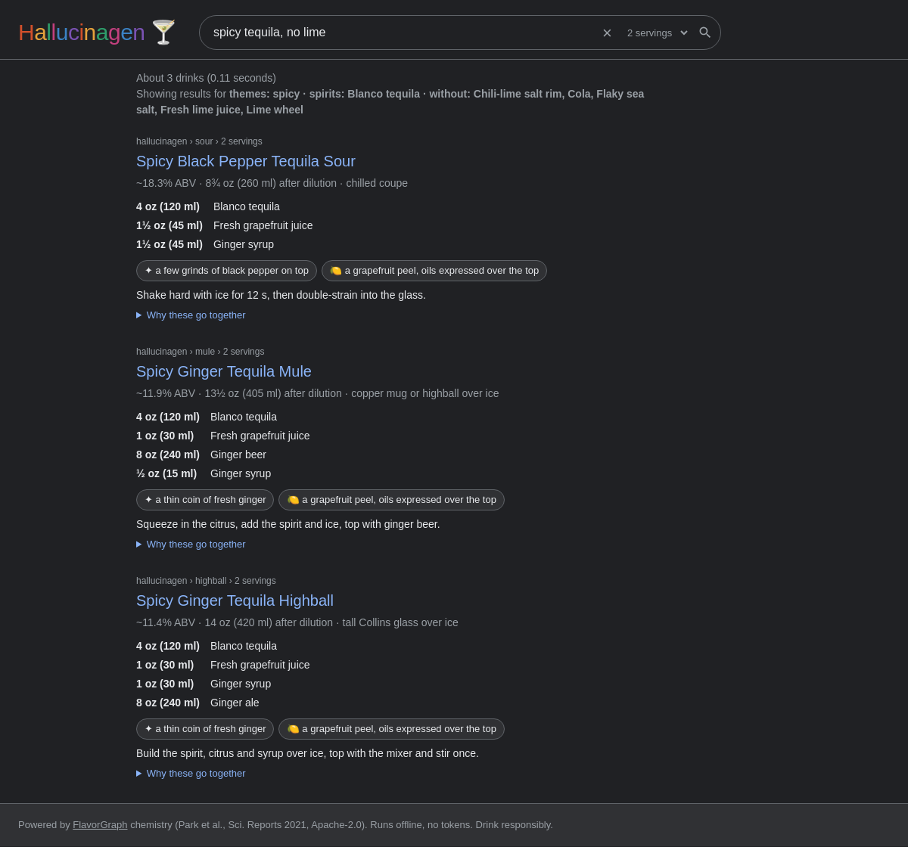
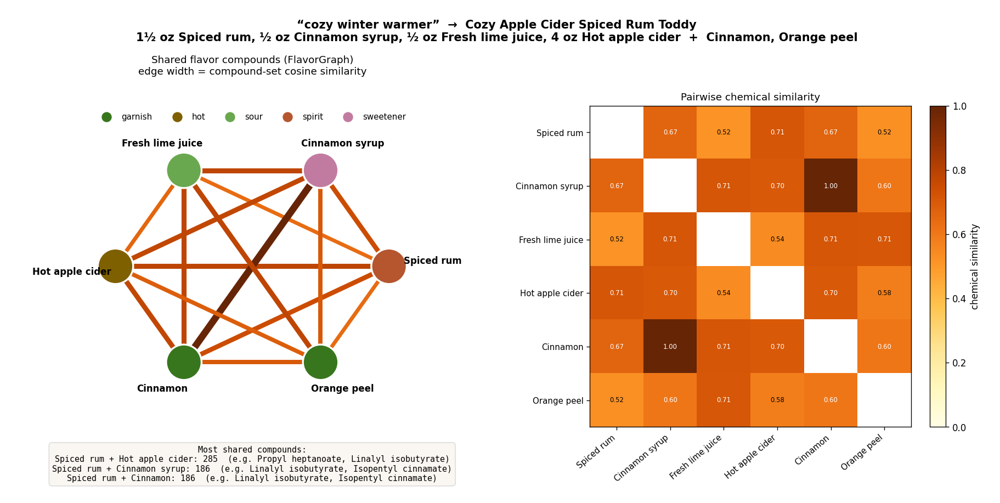
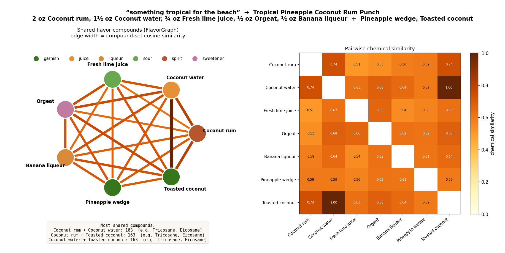
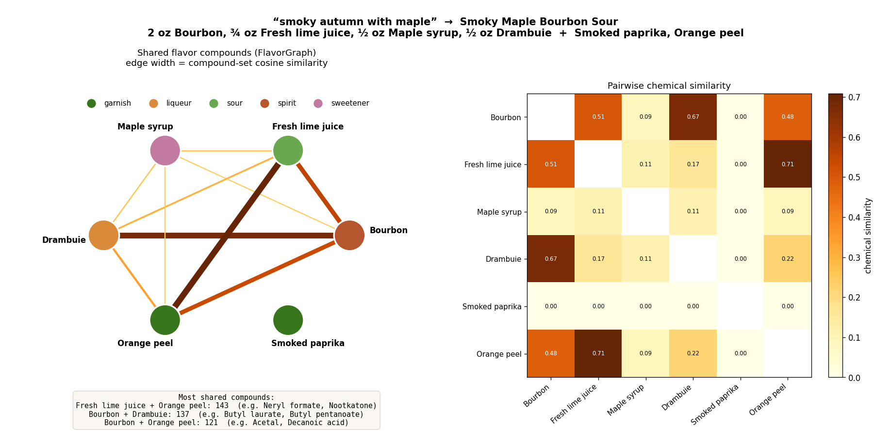
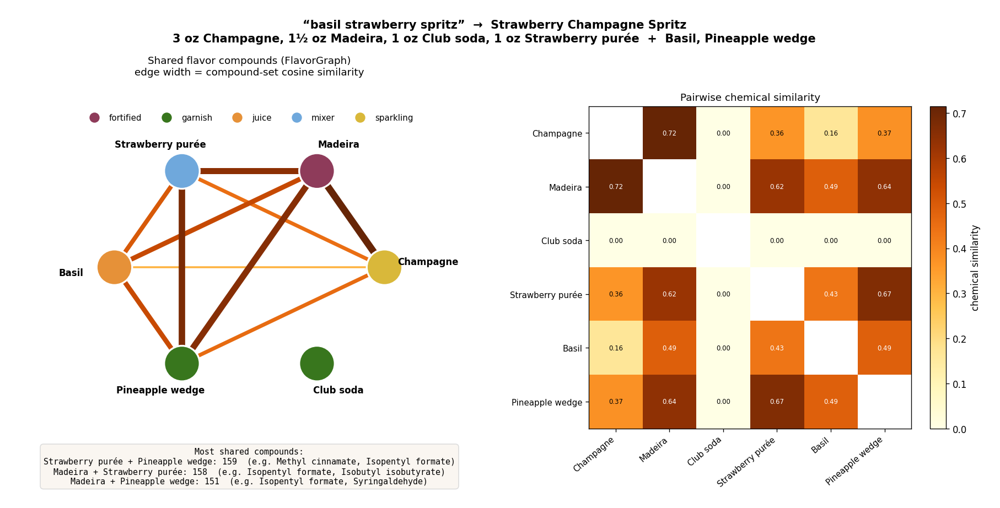

# HalluGin: an offline drink recommender built on FlavorGraph

tldr: generates alcoholic recipes, use your own judgement :3 , tested it at an alcoholic Hackathon. Generally positive reviews 

Built on **[FlavorGraph](https://github.com/lamypark/FlavorGraph)** ([paper](https://www.nature.com/articles/s41598-020-79422-8)): a large-scale food–chemical graph of 6,653 ingredients and 1,645 flavor compounds. Drinks are matched by chemical similarity (shared flavor compounds), recipe pairing scores, and FlavorGraph's ingredient embeddings.

Type a flavor or a theme ("smoky autumn with maple", "tropical but no coconut", "basil strawberry spritz").
It returns three cocktails with quantities scaled to your servings, a glass, a method, garnishes and
seasonings on top, and a short note on *why* the ingredients fit (shared flavor compounds).

There is no LLM and no network access. Everything runs from `drinkrec/data/flavorgraph.npz` (2.4 MB).

```bash
pip install numpy            # the only dependency (use a venv)
python3 app.py               # Hallucinagen web UI, opens http://127.0.0.1:8765
python3 -m drinkrec "cozy winter warmer" --servings 4        # CLI
python3 -m pytest -q         # tests
```

## Examples

| Prompt | Top drink (1 serving) | On top |
|---|---|---|
| `cozy winter warmer` | Spiced Rum Toddy: 1½ oz spiced rum, ½ oz cinnamon syrup, ½ oz lime, 4 oz hot apple cider | cinnamon stick, orange peel |
| `something tropical for the beach` | Coconut Rum Punch: 2 oz coconut rum, 1½ oz coconut water, ¾ oz lime, ½ oz orgeat, ½ oz banana liqueur | pineapple wedge, toasted coconut rim |
| `spicy tequila, no lime` | Tequila Sour: 2 oz tequila, ¾ oz grapefruit, ¾ oz ginger syrup | black pepper, grapefruit peel |
| `coffee dessert` | Bourbon Flip: 1½ oz bourbon, 1 oz coffee liqueur, 1 oz cream, ¼ oz vanilla syrup | cocoa dust, brandied cherry |
| `basil strawberry spritz` | Strawberry Champagne Spritz: 3 oz champagne, 1½ oz Madeira, 1 oz soda, 1 oz strawberry purée | basil leaf |
| `bitter italian aperitivo` | Campari Gin Stirred: 2 oz gin, ¾ oz Campari, 2 dashes orange bitters | grapefruit peel, cardamom |

### The UI: Hallucinagen 🍸

A search-engine-style page. Type a flavor or theme, pick servings, and hit **Hallucinagen Search**, or try
**I'm Feeling Thirsty** for a random prompt. Results list each drink with quantities, garnishes and seasonings on top,
the method, and a "Why these go together" dropdown that cites shared flavor compounds. Prompts work as links too,
e.g. `http://127.0.0.1:8765/?q=coffee%20dessert&servings=2`.

<p align="center"></p>
<p align="center">
  
  
</p>

### Graph similarity behind the picks

Each figure takes the top drink for a prompt and shows how its ingredients and garnishes connect in FlavorGraph.
Edge width and the heatmap give the cosine similarity of each pair's flavor-compound sets. The box lists the pairs
with the most shared compounds.






Regenerate with `python3 scripts/make_figures.py` (needs matplotlib + networkx).

## How it works
1. **Prompt parsing**: theme words (`themes.py`, ~40 themes and ~120 synonyms), spirit names ("tequila", "no gin"),
   style words (spritz, sour, toddy...), and *any* of FlavorGraph's 6,653 ingredient names. Misspellings are
   fuzzy-matched. "no X" / "without X" excludes items.
2. **Drinkable screen**: only the ~150 items in `catalog.py` can appear in a recipe: spirits, liqueurs,
   vermouths and wines, beer and cider, citrus, syrups, juices, mixers, dairy, bitters, and garnishes or seasonings.
   Foods in the prompt (e.g. "beef") only *steer* the flavor.
3. **Scoring** each catalog item against the prompt, using three FlavorGraph signals turned into percentiles:
   - chemical: cosine overlap of flavor-compound sets (bottled products use base foods, e.g. lime juice → lime)
   - recipe pairing: ingredient–ingredient co-occurrence scores
   - the 300-d FlavorGraph embedding cosine

   Items tagged with the prompt's themes also get a bonus.
4. **Assembly**: eight classic structures (sour, highball, stirred, spritz, flip, toddy, tiki punch, mule). Each slot
   is filled with the best item that also suits what is already in the glass. Then a garnish and a seasoning are
   added (cinnamon, nutmeg, chili salt, mint...), quantities are scaled, and ABV is estimated.

Rebuild the data from a FlavorGraph checkout: `python3 scripts/build_data.py path/to/FlavorGraph`.

Data: [FlavorGraph](https://github.com/lamypark/FlavorGraph) (Park et al., *Scientific Reports* 2021),
Apache-2.0, see `drinkrec/data/FLAVORGRAPH_LICENSE`.
